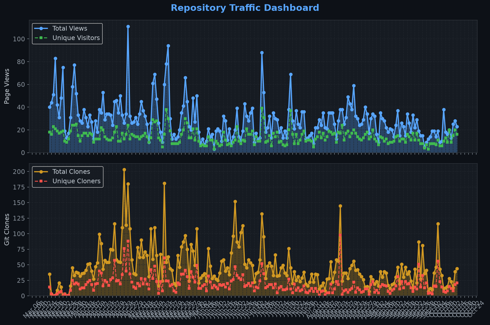
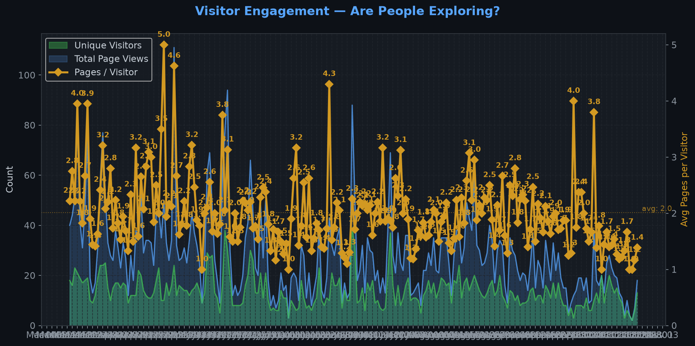
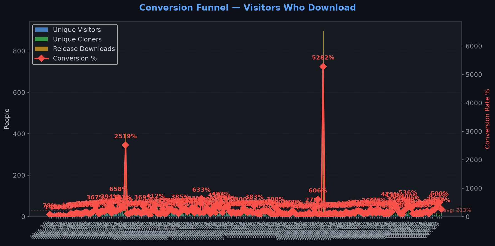
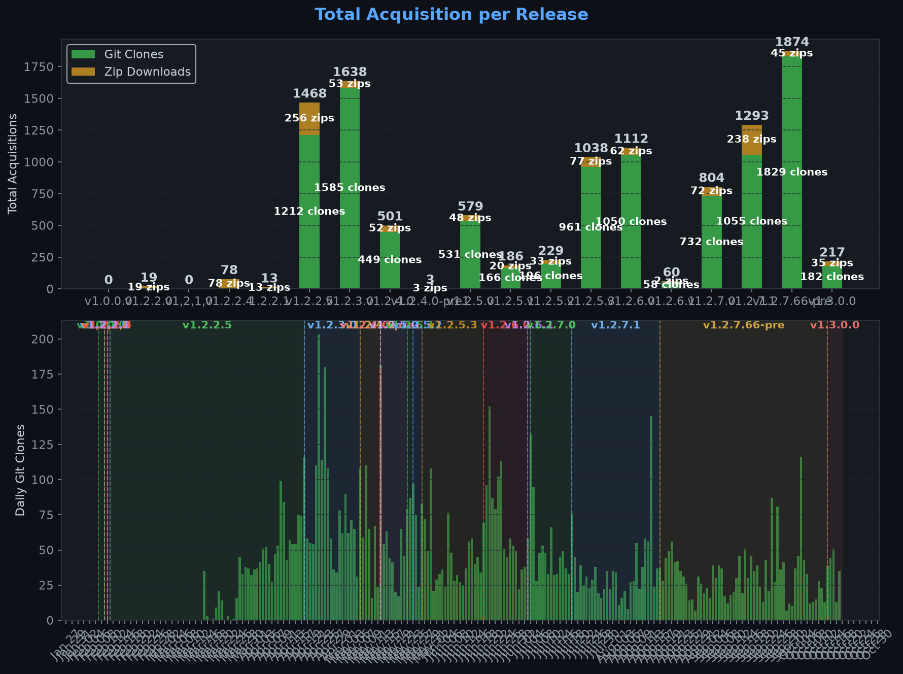
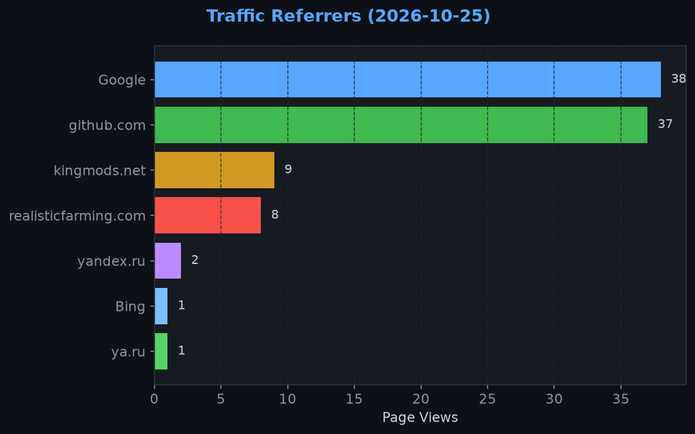
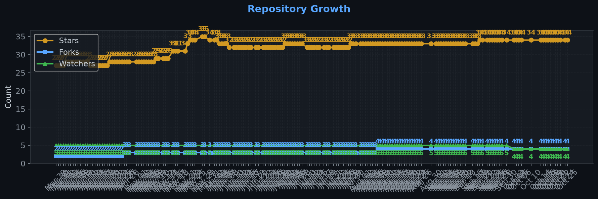

# Repository Traffic Dashboard

**Last updated:** 2026-10-22T06:41:20Z
**Days tracked:** 175 | **Download snapshots:** 869 (hourly)

---

## Views & Clones (14-day window, preserved forever)

| Metric | 14-Day Total | Unique |
|--------|-------------|--------|
| Page Views | 258 | 147 |
| Git Clones | 368 | 148 |

> **Engagement:** 1.7 pages per visitor (14-day avg)

---

## Visitor Engagement

> Higher = visitors exploring more pages. 1.0 = bounce. 3.0+ = deeply engaged.

---

## Conversion Funnel

> **14-day conversion:** 1266 of 147 visitors cloned or downloaded (**861.2%**)
>
> Unique cloners: 148 | Release downloads: 1118

---

## Total Acquisition per Release (Downloads + Clones)

| Channel | Count |
|---------|-------|
| Zip Downloads | 1118 |
| Git Clones (14-day) | 368 |
| **Total Acquisitions** | **1486** |

---

## Referrers

| Source | Views | Unique |
|--------|-------|--------|
| Google | 54 | 42 |
| github.com | 41 | 35 |
| kingmods.net | 9 | 6 |
| realisticfarming.com | 8 | 8 |
| yandex.ru | 2 | 2 |
| chatgpt.com | 2 | 1 |
| Bing | 1 | 1 |
| ya.ru | 1 | 1 |

---

## Repository Growth

| Metric | Current |
|--------|---------|
| Stars | 34 |
| Forks | 4 |
| Watchers | 4 |

---

## Top Pages (14-day)

| Page | Views | Unique |
|------|-------|--------|
| `/Realistic-Farming/FS25_NPCFavor` | 134 | 100 |
| `/Realistic-Farming/FS25_NPCFavor/releases/tag/v1.3.0.0` | 19 | 18 |
| `/Realistic-Farming/FS25_NPCFavor/releases` | 18 | 17 |
| `/Realistic-Farming/FS25_NPCFavor/releases/tag/v1.2.7.1` | 18 | 12 |
| `/Realistic-Farming/FS25_NPCFavor/issues` | 13 | 8 |
| `/Realistic-Farming/FS25_NPCFavor/blob/main/icon_source.png` | 11 | 5 |
| `/Realistic-Farming/FS25_NPCFavor/tree/development` | 6 | 3 |
| `/Realistic-Farming/FS25_NPCFavor/wiki` | 5 | 5 |
| `/Realistic-Farming/FS25_NPCFavor/issues/71` | 5 | 2 |
| `/Realistic-Farming/FS25_NPCFavor/blob/main/docs/relationship-system.md` | 3 | 3 |

---

## Data Files

| File | Description | Granularity |
|------|-------------|-------------|
| [daily.json](daily.json) | Views & clones per day (never expires) | Daily |
| [downloads.json](downloads.json) | Release download snapshots | Hourly |
| [referrers.json](referrers.json) | Referrer snapshots | Daily |
| [metadata.json](metadata.json) | Stars, forks, watchers | Daily |
| [stats.json](stats.json) | Combined legacy snapshots | 6-hourly |

---
*Hourly download tracking + full dashboard with engagement metrics every 6 hours*
*Auto-generated by [traffic-stats.yml](../../.github/workflows/traffic-stats.yml)*
