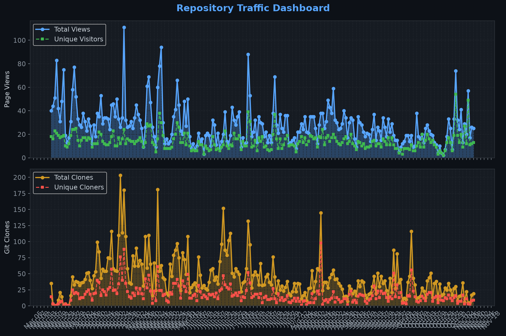
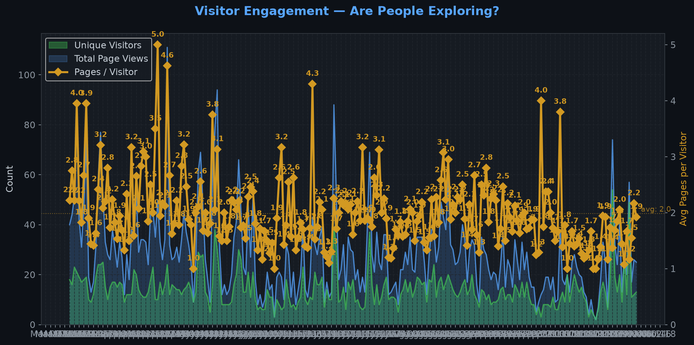
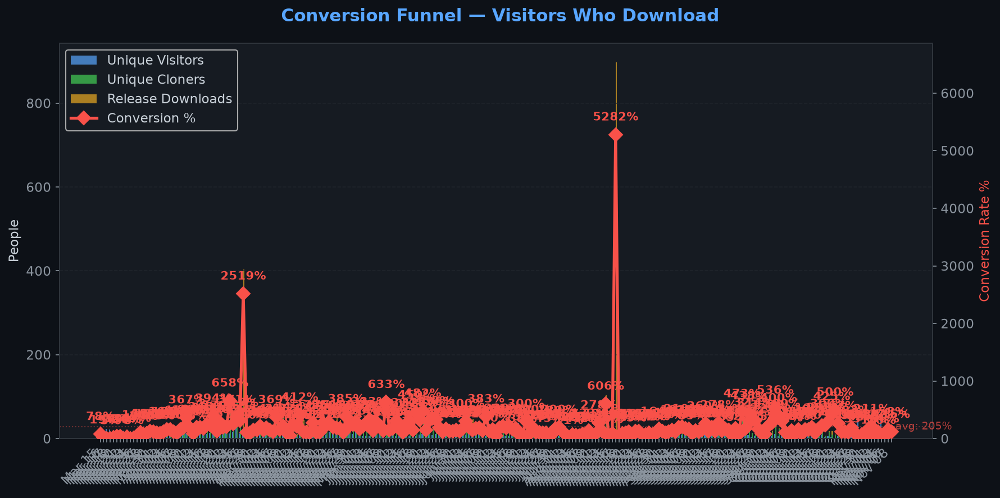
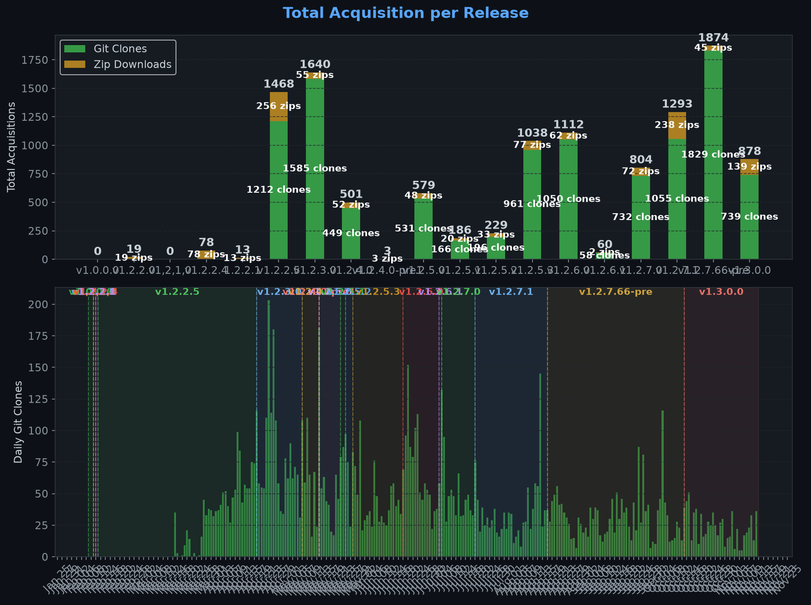
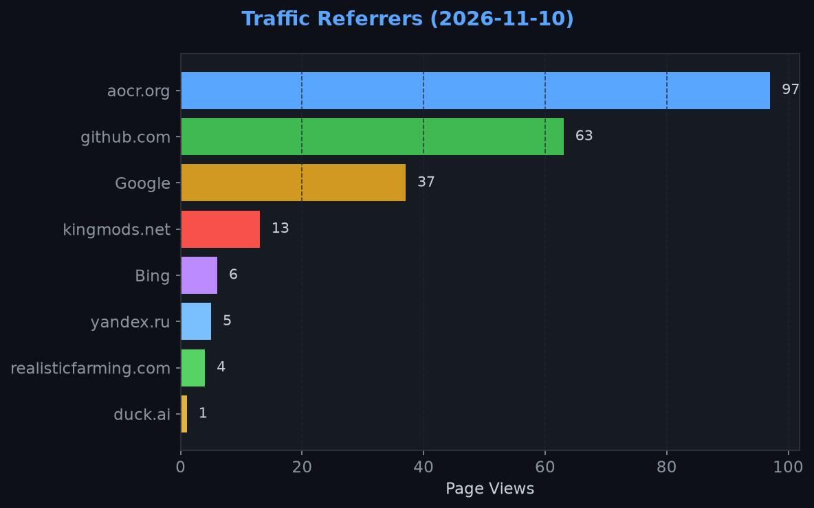
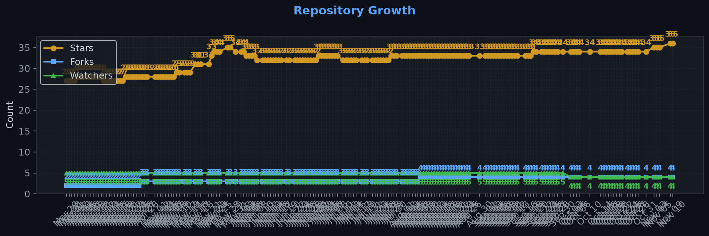

# Repository Traffic Dashboard

**Last updated:** 2026-11-04T18:54:23Z
**Days tracked:** 183 | **Download snapshots:** 908 (hourly)

---

## Views & Clones (14-day window, preserved forever)

| Metric | 14-Day Total | Unique |
|--------|-------------|--------|
| Page Views | 342 | 199 |
| Git Clones | 302 | 110 |

> **Engagement:** 1.7 pages per visitor (14-day avg)

---

## Visitor Engagement

> Higher = visitors exploring more pages. 1.0 = bounce. 3.0+ = deeply engaged.

---

## Conversion Funnel

> **14-day conversion:** 1282 of 199 visitors cloned or downloaded (**644.2%**)
>
> Unique cloners: 110 | Release downloads: 1172

---

## Total Acquisition per Release (Downloads + Clones)

| Channel | Count |
|---------|-------|
| Zip Downloads | 1172 |
| Git Clones (14-day) | 302 |
| **Total Acquisitions** | **1474** |

---

## Referrers

| Source | Views | Unique |
|--------|-------|--------|
| aocr.org | 58 | 58 |
| github.com | 38 | 29 |
| Google | 36 | 29 |
| kingmods.net | 11 | 5 |
| realisticfarming.com | 8 | 7 |
| Bing | 6 | 4 |
| yandex.ru | 6 | 4 |
| search.brave.com | 1 | 1 |

---

## Repository Growth

| Metric | Current |
|--------|---------|
| Stars | 35 |
| Forks | 4 |
| Watchers | 4 |

---

## Top Pages (14-day)

| Page | Views | Unique |
|------|-------|--------|
| `/Realistic-Farming/FS25_NPCFavor` | 160 | 101 |
| `/Realistic-Farming/FS25_NPCFavor/releases/tag/v1.3.0.0` | 30 | 27 |
| `/Realistic-Farming/FS25_NPCFavor/releases` | 23 | 19 |
| `/Realistic-Farming/FS25_NPCFavor/issues` | 10 | 7 |
| `/Realistic-Farming/FS25_NPCFavor/pull/53` | 6 | 6 |
| `/Realistic-Farming/FS25_NPCFavor/issues/64` | 5 | 5 |
| `/Realistic-Farming/FS25_NPCFavor/pull/75/files` | 5 | 5 |
| `/Realistic-Farming/FS25_NPCFavor/issues/15` | 4 | 4 |
| `/Realistic-Farming/FS25_NPCFavor/branches` | 3 | 3 |
| `/Realistic-Farming/FS25_NPCFavor/issues/6` | 3 | 3 |

---

## Data Files

| File | Description | Granularity |
|------|-------------|-------------|
| [daily.json](daily.json) | Views & clones per day (never expires) | Daily |
| [downloads.json](downloads.json) | Release download snapshots | Hourly |
| [referrers.json](referrers.json) | Referrer snapshots | Daily |
| [metadata.json](metadata.json) | Stars, forks, watchers | Daily |
| [stats.json](stats.json) | Combined legacy snapshots | 6-hourly |

---
*Hourly download tracking + full dashboard with engagement metrics every 6 hours*
*Auto-generated by [traffic-stats.yml](../../.github/workflows/traffic-stats.yml)*
